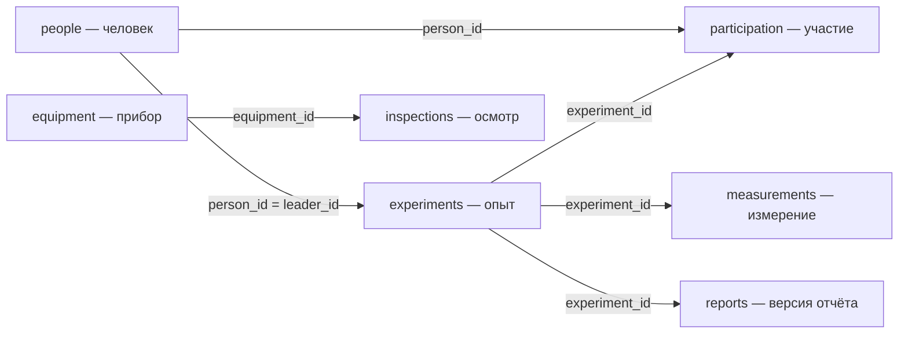
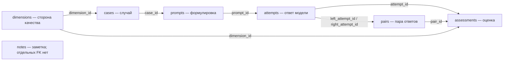

# Две базы данных Дня 11

В проекте есть две разные базы. `data/station.db` содержит вымышленные данные станции: по ним ты устанавливаешь правильный ответ. `src/results.db` содержит твои опыты с моделью: вопросы, ответы и оценки. Ответ модели хранится в журнале. Его доказательство проверяется по станции.

Станцию тебе выдали готовой. Журнал создаёт команда подготовки из `RUN.md`, после этого он пополняется твоими записями. Не нужно переносить таблицы станции в журнал или менять станцию ради вопроса-ловушки.

PK — ключ строки: значение, по которому её можно однозначно найти. FK — ссылка на ключ другой таблицы. Для ключа из двух полей уникальна именно пара значений.

## Карта станции

Стрелка идёт от таблицы с ключом к таблице, которая на него ссылается. Один человек может руководить несколькими опытами; один опыт может иметь много участников, измерений и версий отчёта. Приборы и осмотры — отдельная часть базы: связи прибора с опытом здесь **нет**.

| Таблица | Одна строка означает | PK | FK и другие ограничения |
|---|---|---|---|
| `people` | Одного человека | `person_id` | Ссылок нет. `name` не является уникальным ключом |
| `experiments` | Один опыт | `experiment_id` | `leader_id` → `people.person_id`; `title` не уникален |
| `participation` | Участие одного человека в одном опыте | Пара `experiment_id`, `person_id` | `experiment_id` → `experiments.experiment_id`; `person_id` → `people.person_id` |
| `measurements` | Одну запись измерения | `measurement_id` | `experiment_id` → `experiments.experiment_id` |
| `equipment` | Один физический прибор | `equipment_id` | `serial` уникален; название прибора не уникально |
| `inspections` | Один осмотр прибора в определённый момент | `inspection_id` | `equipment_id` → `equipment.equipment_id` |
| `reports` | Одну версию отчёта по опыту | `report_id` | `experiment_id` → `experiments.experiment_id`; пара `experiment_id`, `version` уникальна |

Руководитель (`leader_id`) и участник (`participation`) — разные связи. Руководитель не обязан находиться в списке участников.

До расчёта уточни, что считать: опыт, человека, участие или измерение. При соединении опыта с измерениями одна строка опыта повторится для каждого измерения. Это ожидаемое поведение JOIN, но такой результат нельзя автоматически считать числом опытов.

`NULL` в измерении означает, что число неизвестно. Ноль — известное число. Перед сравнением измерений согласуй единицы. У отчёта учитывай версию и дату публикации; у осмотра — момент, в который состояние было зафиксировано. Подробности находятся в `materials/database_rus.md`.

## Карта журнала

Случай — то, что ты хочешь проверить. Формулировка — точные слова вопроса. Попытка — один полученный ответ. Если задашь тот же вопрос ещё раз, появится новая попытка, а формулировка останется прежней.

| Таблица | Одна строка означает | PK | FK и важное ограничение |
|---|---|---|---|
| `dimensions` | Одну из пяти сторон качества | `dimension_id` | Ссылок нет; список уже задан |
| `cases` | Один подготовленный случай с ожиданием и доказательством | `case_id` | `dimension_id` → `dimensions.dimension_id`; для `stability` вид `kind` равен `pair` |
| `prompts` | Одну точную формулировку случая | `prompt_id` | `case_id` → `cases.case_id` |
| `attempts` | Один ответ модели с контекстом и условиями | `attempt_id` | `prompt_id` → `prompts.prompt_id` |
| `pairs` | Два ответа, сопоставленные для проверки устойчивости | `pair_id` | `left_attempt_id` и `right_attempt_id` → `attempts.attempt_id`; ответы разные; одинаковая упорядоченная пара не дублируется |
| `assessments` | Одну текущую ручную оценку ответа **или** пары | `assessment_id` | `dimension_id` → `dimensions.dimension_id`; заполнен ровно один из `attempt_id` → `attempts.attempt_id` и `pair_id` → `pairs.pair_id` |
| `notes` | Одну заметку с темой и текстом | `note_id` | Ссылок нет |

Один ответ можно оценить по нескольким сторонам качества. Поэтому у него бывает несколько строк `assessments`. Для одного ответа и одной стороны качества хранится одна текущая оценка. Оценка пары относится только к `stability` и ссылается на `pair_id`, а не на `attempt_id`.

Запись пары сама по себе не доказывает сравнимость ответов. Ты проверяешь, что они относятся к одному случаю, одной модели и одному этапу и что условия сопоставимы. Не создавай повтор той же пары в обратном порядке.

В `attempts.phase` находятся `main` — основная серия, `peer` — обмен с другим участником, `defense` — попытки после изменения контекста. В `cases.kind`: `normal` — обычный случай, `challenge` — трудный, `pair` — случай на устойчивость. Это разные признаки: вид случая и этап попытки нельзя подменять друг другом.

## Как прочитать результат JOIN

Прежде чем считать строки результата, скажи себе: «Одна строка этого запроса — это…». Если ответ неясен, пока не считай процент.

Соединение `attempts` с `assessments` повторяет попытку для каждой её оценки. `COUNT(*)` после такого соединения считает строки соединения. Для подсчёта попыток нужно выбрать соответствующий ключ или сначала свести оценки к одной строке на попытку. Пары и отдельные ответы учитываются раздельно.

Отсутствие оценки не означает `pass`. `unclear` и `na` — также самостоятельные результаты. Пустая группа не является успешной.

